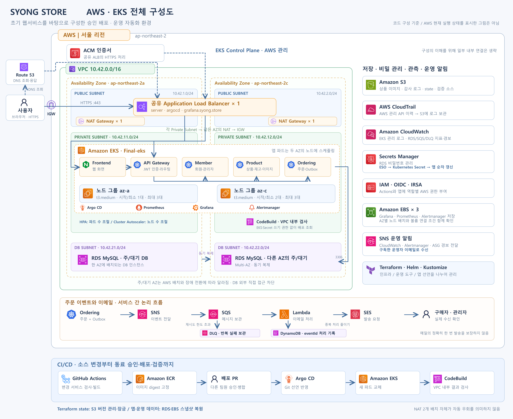
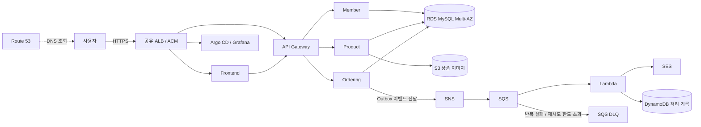

# AWS EKS 웹서비스 재배포 · 운영 자동화

개발자에게 전달받은 회원·상품·주문 웹서비스를 테스트 환경에서 확인한 뒤, AWS EKS에 재배포하고 운영 환경을 개선한 팀 프로젝트입니다.

**초기 동작 확인 → Terraform 구축 → 동료 승인 배포 → 운영 검증 → 백업·복원 → 새 환경 재배포** 과정을 연결했습니다. 앱 전체를 처음부터 개발한 프로젝트가 아니라, 기존 서비스를 배포하고 운영하는 과정을 중심으로 정리했습니다.

> 이 저장소는 [팀 최종 프로젝트](https://github.com/yobi84-sy/aws-msa-final-test2)의 `main`과 커밋 이력을 가져온 제출·정리용 저장소입니다. 코드의 계정·도메인·저장소 참조는 `yonginfra` 환경으로 변경했습니다. **이번 복사 작업에서는 AWS를 실행하거나 새 환경 배포를 검증하지 않았습니다.** 이전 환경의 실습 결과와 현재 코드의 로컬 검사 결과를 구분합니다.

## 프로젝트 문서

기존 README의 주제별 구성과 기술 설명은 살리고, 최종 코드와 발표 자료에 맞춰 정리했습니다.

| 문서 | 내용 |
| --- | --- |
| [프로젝트 개요](docs/final/01-overview.md) | 시작 배경, 초기 구성과 개선 내용, 팀 역할 |
| [구성과 기술 역할](docs/final/02-architecture.md) | 두 AZ 배치, ALB, RDS, EBS, 비밀번호·알림 흐름 |
| [배포 자동화와 버전 변경](docs/final/03-deployment.md) | 변경 서비스 빌드, PR 승인, V1·V2·롤백·V3 |
| [운영 검증과 복원](docs/final/04-validation.md) | 확장, 데이터 유지, 장애 전환, 새 환경 재배포 |
| [문제 해결과 개선 과제](docs/final/05-troubleshooting.md) | Grafana 503, OIDC, 필수 입력 오류와 남은 범위 |
| [실행·설정 가이드](docs/final/06-runbook.md) | 환경 확인, 설치·검증·보존·복원·삭제 명령 |
| [복사 출처와 환경 변경](docs/final/07-migration.md) | 원본 커밋, 변경값, 이미지와 GitHub 설정의 이전 범위 |
| [이번 로컬 검사 결과](docs/final/08-local-checks.md) | AWS 없이 실행한 검사와 미실행 항목 |
| [노션용 문서](docs/notion/00-프로젝트-홈.md) | 주제별 Markdown 페이지와 가져오기 안내 |

이전 상세 문서는 `docs/01-architecture.md`부터 이어지는 파일에 보존했습니다. 시점별 준비안·과거 결과가 섞여 있으므로 **현재 구성은 위 `docs/final` 문서를 우선** 확인합니다. [이전 README 원문](docs/archive/README-source-20261104.md)도 남겼습니다.

## 전체 구성

[](docs/images/architecture.png)

[고해상도 PNG](docs/images/architecture.png) · [확대 가능한 SVG](docs/images/architecture.svg) · [구성도 읽는 방법](docs/final/02-architecture.md)

<details>
<summary>서비스 연결 흐름을 텍스트로 보기</summary>



</details>

앱과 운영 도구는 EKS에 배치합니다. 위 그림은 서비스 흐름을 요약한 것이며 네트워크 경계를 모두 표시한 배치도는 아닙니다.

| 영역 | 현재 코드 구성 |
| --- | --- |
| 네트워크 | VPC 1개, AZ 2개, 서브넷 6개, AZ별 NAT 1개씩 |
| 외부 접속 | ALB 1개 공유, Route 53 도메인, ACM HTTPS |
| 실행 환경 | EKS 1개, AZ별 노드 그룹 2개, t3.medium 총 3대 시작·최대 6대 |
| 업무 데이터 | 비공개 RDS MySQL Multi-AZ, 상품 이미지 S3 |
| 운영 데이터 | Grafana·Prometheus·Alertmanager용 EBS 3개 |
| 배포 | Actions, ECR, 이미지 digest, 동료 승인 PR, Argo CD, CodeBuild |
| 비밀·권한 | GitHub OIDC, IRSA, Secrets Manager, ESO |
| 관측·감사 | Prometheus, Grafana, Alertmanager, CloudWatch, CloudTrail |
| 주문 알림 | Outbox, SNS, SQS, Lambda, SES, DynamoDB, DLQ |

## 배포 흐름

```text
앱 소스 변경 → 변경 서비스 검사·이미지 빌드 → ECR 게시
→ 배포 이미지 변경 PR → 다른 팀원 승인·병합 → Argo CD 반영
→ CodeBuild에서 배포 버전·이미지·준비 상태·HTTPS·API 검사
```

- 일반 변경은 관련 서비스만 테스트·빌드합니다. 공통 CI 변경이나 최초 전체 빌드는 예외입니다.
- 이미지 게시 성공, Argo CD의 Synced·Healthy, 사용자 기능 정상 동작은 각각 확인합니다.
- 배포 이미지는 Git의 태그·digest와 `deploy/release.json`으로 추적합니다.
- 승인 강제는 workflow 파일만으로 완성되지 않습니다. 팀원 권한과 GitHub 브랜치 보호 설정이 필요합니다.
- 현재 복사된 이미지 digest는 **원본 환경의 이력**입니다. 본인 ECR에서 전체 이미지를 새로 게시하고 배포 PR을 만든 뒤 사용해야 합니다.

## 기존 구성에서 개선한 내용

| 개선 | 프로젝트에서 사용한 이유 |
| --- | --- |
| ALB·ACM | 웹사이트·Argo CD·Grafana의 접속과 인증서 관리 정리 |
| Terraform·S3 state·잠금 | 같은 환경을 다시 만들고 공동 작업의 상태 충돌 방지 |
| 서비스별 빌드·승인 PR | 불필요한 빌드를 줄이고 검토한 이미지 변경만 반영 |
| CodeBuild 내부 검사 | VPC 내부에서 실제 배포 상태와 서비스 응답 확인 |
| Secrets Manager·ESO | DB 비밀번호 관리와 Kubernetes Secret 동기화 |
| 상태 검사·파드 2개·PDB | 프런트엔드 교체와 노드 점검 시 가용 파드 유지 조건 구성 |
| RDS Multi-AZ·AZ별 NAT | DB 전환과 외부 통신 경로 분리 |
| EBS·스냅샷 복원 | 업무 데이터와 모니터링 기록을 복원 전후 비교 |
| Outbox·재고 예약/보상 | 이벤트 누락 위험과 주문 실패 시 재고 복구를 처리 |
| 비동기 이메일·DLQ | 주문 저장과 메일을 분리하고 반복 실패 메시지를 보관 |

## 검증에서 보여준 내용

기존 환경의 기록과 최종 발표 자료에서는 다음을 확인했습니다. **이 복사본에서 새로 AWS 검증을 수행했다는 뜻은 아닙니다.**

- V1 기준 버전, V2 상세 링크 오류 재현, V1 롤백, 회귀 검사 추가 후 V3 배포
- HPA의 파드 확장·축소와 Cluster Autoscaler의 노드 확장·축소
- 파드 교체 후 업무 데이터와 Grafana 대시보드 유지
- RDS 전환 중 연결 실패와 이후 같은 endpoint로 연결·데이터 회복
- 별도 NAT 시험 환경의 차단·우회·복귀 관측
- 비밀번호 변경과 ESO 동기화 후 앱 재연결
- 주문 메일 수신, 실패 메시지 DLQ 보관, CloudWatch ALARM에서 OK 복귀
- RDS·EBS 스냅샷 복원 후 업무 데이터와 운영 기록 대조
- 다른 AWS 환경에서 구축·배포 절차와 권한 제한 재검증

V2 오류는 격리된 시험 환경에서 재현한 배포 시나리오입니다. NAT 두 개만 배치하면 자동 우회하는 것은 아니며, 별도 제어기 시험을 전체 앱의 무중단 검증과 혼동하지 않습니다. 일부 백엔드와 운영 도구는 단일 파드이고, RDS 전환·비밀번호 변경 중 영향도 있을 수 있습니다. [확인 범위](docs/final/04-validation.md)

## 저장소 구조

```text
terraform-state-bootstrap/  # state용 S3 버킷
terraform/                  # 네트워크·EKS·RDS·IAM·AWS 서비스
terraform-k8s/              # EKS 운영 도구·Argo CD·ESO·모니터링
app/msa/                    # 앱 소스·Kustomize·Kubernetes 매니페스트
lambda/order_email/         # 주문 이메일 소비자
.github/workflows/          # CI·배포 PR·승인 검사·배포 검증
deploy/release.json         # 서비스별 소스 SHA와 이미지 digest
scripts/                    # 설치·검증·복원·삭제·운영 도구
tests/                      # AWS API를 대체한 로컬 회귀 검사
docs/final/                 # 최종 프로젝트 설명
docs/notion/                # 노션 가져오기용 페이지
docs/archive/               # 원본 README·이전 배포 선언
```

## 실행 안내

이번 정리에서는 AWS를 실행하지 않았습니다. 먼저 [설정·실행 가이드](docs/final/06-runbook.md)와 [환경 변경 내용](docs/final/07-migration.md)을 확인하세요. 계정·도메인·state 경로가 본인의 실제 환경과 맞는지 검토하고, 기존 state가 있다면 별도로 확인해야 합니다.

설치, 검증, 복원, 삭제 명령은 목적이 다르므로 한꺼번에 실행하지 않습니다. GitHub의 Secrets·Variables·팀원 권한·브랜치 보호·기존 AWS 자원은 Git 복사로 이전되지 않습니다.

## 출처와 팀 작업

기존 웹소스를 바탕으로 각 팀원이 확장한 내용을 비교하고, [팀 최종 저장소](https://github.com/yobi84-sy/aws-msa-final-test2)를 기준으로 통합했습니다. 이 저장소에는 원본 커밋 이력과 MIT 라이선스를 유지했습니다. 인프라와 운영 구성, 앱 보완, 비동기 알림, 검증 기록은 팀 작업 결과이며 특정 개인이 모든 기능을 단독 개발한 것으로 표현하지 않습니다. [복사 기준 커밋과 변경 내역](docs/final/07-migration.md)
