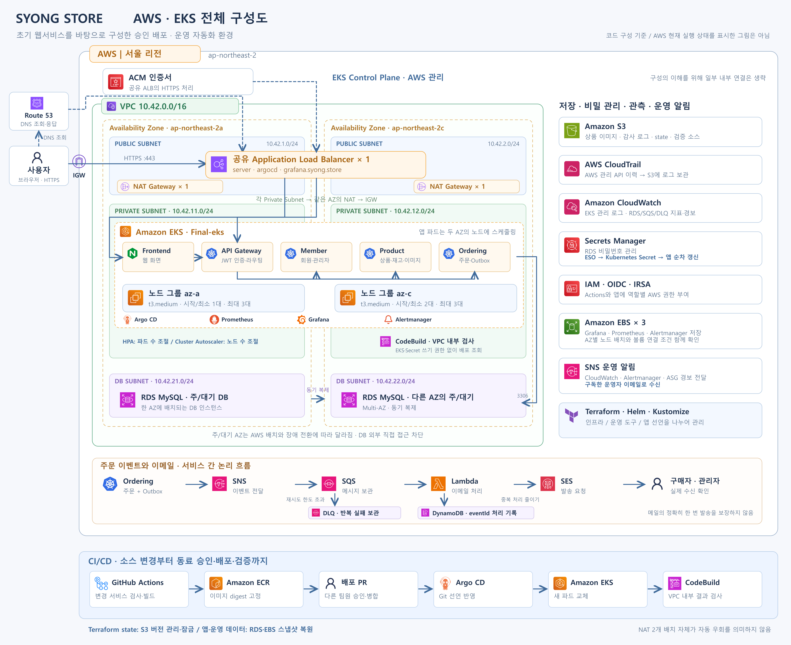

# 구성과 기술 역할

[](../images/architecture.png)

[원본 크기로 보기](../images/architecture.png) · [SVG 파일](../images/architecture.svg)

그림은 현재 코드 구성을 나타냅니다. 왼쪽에서 접속과 두 AZ의 서브넷·EKS·DB 배치를 보고, 오른쪽에서 저장·비밀번호·관측 서비스를 확인합니다. 아래쪽은 주문 이메일과 승인 배포의 논리 흐름입니다. RDS 주/대기 AZ는 AWS 배치와 전환에 따라 바뀔 수 있으며, 앱별 AZ를 고정 배정한 그림은 아닙니다.


## 네트워크와 배치

서울 리전의 두 AZ에 퍼블릭·프라이빗·DB 서브넷을 각각 배치합니다. 퍼블릭 구역에는 공유 ALB와 AZ별 NAT를, 프라이빗 구역에는 EKS 노드를 둡니다. RDS는 비공개로 구성하고 EKS 보안 그룹에서 MySQL 3306 접근을 허용합니다. EKS 관리 API는 내부 endpoint와 지정 공인 IP로 제한한 외부 endpoint를 사용합니다.

노드 그룹은 AZ별로 분리합니다. az-a는 시작·최소 1대, az-c는 시작·최소 2대이며 각 그룹 최대 3대입니다. 파드는 노드에 스케줄링되므로 서비스마다 EC2 한 대를 고정 배정한 구조가 아닙니다.

## 사용자 요청

```text
Route 53으로 DNS 조회 → 공유 ALB의 HTTPS 접속
→ Frontend 또는 앱 API Gateway → Member / Product / Ordering
→ RDS 업무 데이터, S3 상품 이미지
```

Route 53은 주소를 응답하며 웹 요청을 중계하지 않습니다. ACM 인증서는 ALB에 적용합니다. 앱의 API Gateway는 프로젝트의 Spring 서비스이며 AWS API Gateway 서비스가 아닙니다. Kubernetes Ingress 리소스는 ALB Controller가 라우팅을 구성하기 위한 선언으로 남아 있고, NGINX Ingress Controller를 최종 요청 경로에 두는 구조는 아닙니다.

## 저장과 비밀번호

| 기술 | 이 프로젝트에서 맡은 역할 |
| --- | --- |
| RDS Multi-AZ | 주 DB와 다른 AZ의 동기 대기 DB. 대기 DB는 읽기 분산용 복제본이 아님 |
| S3 | 상품 이미지·CloudTrail 로그·Terraform state·CodeBuild 소스 보관 |
| EBS | Grafana·Prometheus·Alertmanager의 영구 저장 공간. 파드 교체 후 다시 연결 |
| Secrets Manager | RDS 관리 비밀번호 보관·변경 관리 |
| ESO | Secrets Manager 값을 Kubernetes Secret에 동기화 |
| 앱 갱신 도구 | Secret 변경을 앱에 반영하도록 순차 갱신하고 DB 준비 상태 확인 |

EBS 볼륨은 한 AZ에 속합니다. 다른 AZ의 노드에 그대로 연결할 수 없으므로 파드의 AZ·자원·배치 조건을 함께 맞춰야 합니다. 스냅샷 복원은 새 볼륨을 생성하는 작업입니다.

## 배포와 관측

Helm은 Argo CD·모니터링 같은 운영 도구를 차트로 설치·관리합니다. Kustomize는 앱의 Kubernetes 선언과 서비스별 이미지 태그·digest를 조합합니다. Prometheus는 지표 수집·저장, Grafana는 시각화, Alertmanager는 경보 전달을 담당합니다. CloudWatch는 AWS 지표·로그·경보, CloudTrail은 AWS 관리 API 작업 이력을 담당합니다. HPA는 파드 수, Cluster Autoscaler는 배치할 노드 수를 조절합니다.

## 주문과 이메일

```text
주문·Outbox 기록 → SNS → SQS → Lambda → SES → 구매자·관리자
                              └ 처리 기록: DynamoDB
SQS 반복 처리 실패 → 재시도 한도 초과 → DLQ
```

Outbox는 별도 AWS 서비스가 아니라 주문과 발송할 이벤트를 DB에 함께 기록하는 방식입니다. 주문·재고 서비스는 예약·확정·해제 API로 협력하고 중복 요청과 실패 복구 상태를 관리합니다. 한 DB 트랜잭션이 서비스 간 통신과 메일 발송까지 모두 묶는 것은 아닙니다. DynamoDB 기록은 중복 처리를 줄이지만 SES 발송 성공 후 기록 저장이 실패하는 경우 중복 메일 가능성은 남습니다.

NAT 2개 배치만으로 자동 우회가 구성되지는 않습니다. 별도 NAT 제어기 시험은 이 저장소의 기본 인프라와 전체 서비스 HA 보장으로 확대 해석하지 않습니다.
